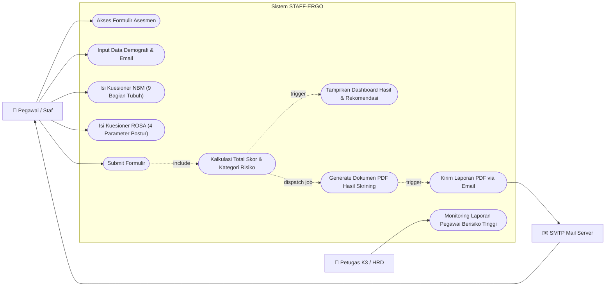
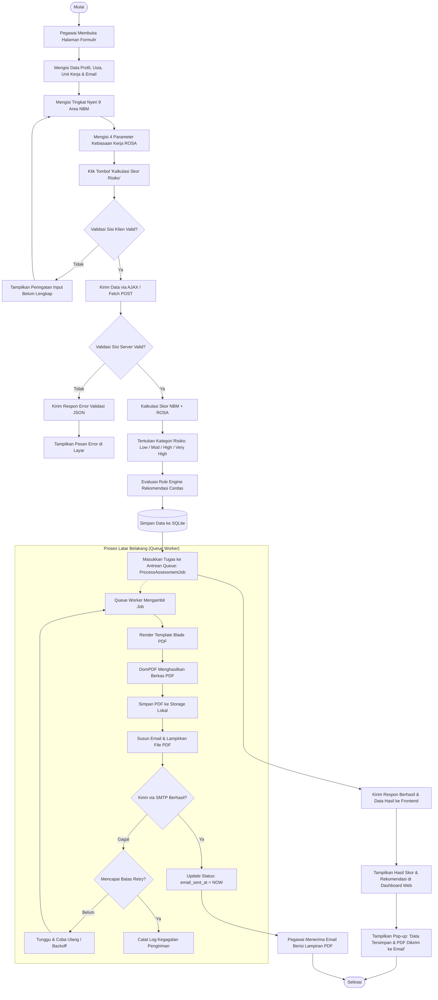
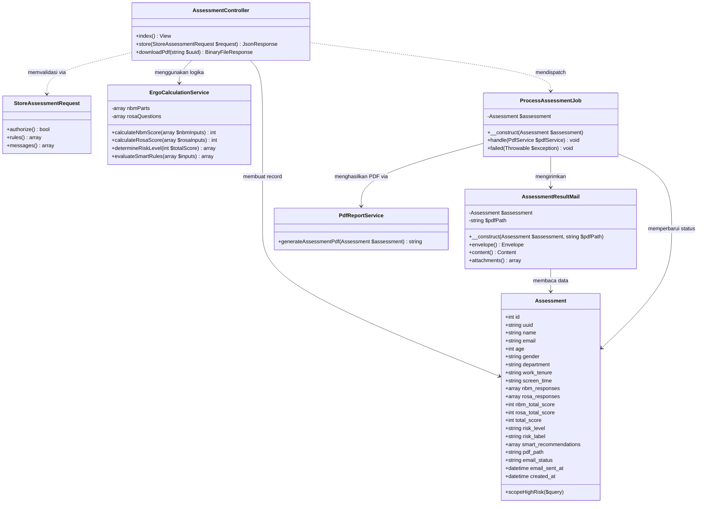

# Rencana Desain & Arsitektur Sistem: Workplace Ergonomic Assessment Tool (STAFF-ERGO)

Dokumen ini merupakan perencanaan teknis terstruktur dan komprehensif untuk membangun aplikasi web **STAFF-ERGO** (*Sistem Skrining Ergonomi & Muskuloskeletal di Tempat Kerja*) berbasis **Laravel 11** dan database **SQLite**. Dokumen ini mencakup analisis kebutuhan, pemodelan sistem UML (*Use Case*, *Activity Diagram*, dan *Class Diagram*), desain basis data, logika klinis skoring, pembuatan laporan PDF, serta mekanisme antrean pengiriman email secara asinkron.

---

## 1. Pendahuluan & Analisis Kebutuhan

### 1.1 Latar Belakang
Gangguan otot rangka akibat kerja (*Work-related Musculoskeletal Disorders* / WMSDs) merupakan salah satu masalah kesehatan kerja tertinggi pada pekerja kantor dan staf medis akibat postur statis, durasi duduk yang panjang, dan pengaturan workstation yang belum ergonomis. Sistem **STAFF-ERGO** menyediakan alat asesmen mandiri (*self-assessment*) berbasis web yang cepat, ilmiah, dan otomatis memberikan panduan intervensi langsung ke tangan pegawai.

### 1.2 Kebutuhan Fungsional (*Functional Requirements*)
1. **Pengisian Data Demografi**: Menginput Nama/Inisial, Email, Usia, Jenis Kelamin, Unit Kerja (Medis/Non-Medis), Masa Kerja, dan Durasi Kerja di depan layar.
2. **Asesmen Nordic Body Map (NBM)**: Menilai intensitas keluhan nyeri pada 9 area anatomi tubuh (skala 1 s/d 4).
3. **Asesmen Rapid Office Strain Assessment (ROSA)**: Mengevaluasi 4 faktor risiko postur dan fasilitas workstation (skala 1 s/d 3).
4. **Kalkulasi Skor Otomatis**: Menghitung total skor kumulatif (rentang 13–48) dan mengelompokkan pegawai ke dalam salah satu dari 4 kategori risiko (*Low*, *Moderate*, *High*, *Very High*).
5. **Rekomendasi Cerdas (*Rule Engine*)**: Menganalisis korelasi antara keluhan spesifik dan kebiasaan kerja untuk memunculkan instruksi ergonomi serta tautan video peregangan (*stretching*).
6. **Notifikasi Langsung (*On-Screen Feedback*)**: Menampilkan umpan balik visual instan di dashboard tanpa me-*reload* halaman.
7. **Pembuatan Dokumen Laporan PDF**: Membuat file PDF resmi (*Occupational Health Report*) secara dinamis.
8. **Pengiriman Email Asinkron**: Mengirimkan email konfirmasi berisikan ringkasan hasil asesmen dan melampirkan berkas PDF ke alamat email yang diinputkan pegawai.

### 1.3 Kebutuhan Non-Fungsional (*Non-Functional Requirements*)
- **Performa**: Respon pengiriman form pada antarmuka pengguna $< 1$ detik; rendering PDF dan pengiriman email dialihkan ke latar belakang (*background job queue*).
- **Keandalan**: Kegagalan koneksi SMTP tidak boleh menggagalkan penyimpanan data asesmen (tersedia mekanisme *retry queue*).
- **Portabilitas & Kemudahan Deployment**: Menggunakan SQLite yang tidak memerlukan instalasi server database eksternal.
- **Responsivitas Antarmuka**: Tampilan modern (*Cyberpunk / Glassmorphism*) yang ramah dibuka melalui peramban desktop maupun ponsel pintar.

---

## 2. Pemodelan Sistem UML (Unified Modeling Language)

### 2.1 Use Case Diagram

Diagram Use Case memetakan interaksi antara **Pegawai / Staf**, **Sistem STAFF-ERGO**, **Petugas K3 (Safety Officer)**, dan **Mail Server**.



#### Deskripsi Use Case:
- **UC1 s/d UC5**: Pegawai mengakses aplikasi, melengkapi data identitas dan email, menjawab penilaian nyeri otot (NBM) serta postur kerja (ROSA), lalu menekan tombol kalkulasi.
- **UC6**: Sistem mengevaluasi total skor dan *Smart Rules* untuk menghasilkan tingkat risiko.
- **UC7**: Hasil ditampilkan seketika pada antarmuka web.
- **UC8 & UC9**: Laporan PDF di-generate di latar belakang dan disalurkan ke alamat email pegawai melalui Mail Server.
- **UC10**: Data tersimpan di database siap dipantau oleh tim K3, khususnya bagi pegawai dengan status risiko tinggi (*High* / *Very High*).

---

### 2.2 Diagram Aktivitas (*Activity Diagram*)

Diagram Aktivitas mengilustrasikan alur proses end-to-end mulai dari pengguna membuka form hingga penerimaan email laporan PDF.



---

### 2.3 Class Diagram (Arsitektur Berorientasi Objek)

Class diagram berikut menggambarkan struktur kode dalam pola arsitektur MVC (*Model-View-Controller*) dengan *Service Layer* dan *Job Queue* di Laravel 11.



---

## 3. Desain Basis Data (SQLite)

Penggunaan SQLite dipilih karena kemudahan operasional (*single file*, portabel, *zero latency connection*, cocok untuk pengujian lokal maupun server internal instansi).

### 3.1 Struktur Tabel `assessments`

```sql
CREATE TABLE assessments (
    id INTEGER PRIMARY KEY AUTOINCREMENT,
    uuid VARCHAR(36) NOT NULL UNIQUE,
    name VARCHAR(100) NOT NULL,
    email VARCHAR(150) NOT NULL,
    age INTEGER NOT NULL,
    gender VARCHAR(10) NOT NULL, -- 'L' atau 'P'
    department VARCHAR(50) NOT NULL, -- 'Medis' atau 'Non Medis'
    work_tenure VARCHAR(50) NOT NULL, -- '< 1 tahun', '1-3 tahun', '> 3 tahun'
    screen_time VARCHAR(50) NOT NULL, -- '< 4 jam', '4-6 jam', '> 6 jam'
    nbm_responses TEXT NOT NULL, -- Format JSON: {"b1": 2, "b2": 3, ..., "b9": 1}
    rosa_responses TEXT NOT NULL, -- Format JSON: {"c1": 2, "c2": 3, "c3": 1, "c4": 2}
    nbm_total_score INTEGER NOT NULL, -- 9 - 36
    rosa_total_score INTEGER NOT NULL, -- 4 - 12
    total_score INTEGER NOT NULL, -- 13 - 48
    risk_level VARCHAR(30) NOT NULL, -- 'low', 'moderate', 'high', 'very_high'
    risk_label VARCHAR(100) NOT NULL, -- 'Risiko Rendah', dsb.
    smart_recommendations TEXT NULL, -- Format JSON: array rekomendasi yang terpicu
    pdf_path VARCHAR(255) NULL,
    email_status VARCHAR(20) DEFAULT 'pending', -- 'pending', 'sent', 'failed'
    email_sent_at DATETIME NULL,
    created_at DATETIME NULL,
    updated_at DATETIME NULL
);

CREATE INDEX idx_assessments_email ON assessments(email);
CREATE INDEX idx_assessments_risk_level ON assessments(risk_level);
CREATE INDEX idx_assessments_created_at ON assessments(created_at);
```

### 3.2 Tabel Penunjang Antrean: `jobs` dan `failed_jobs`
Dihasilkan secara standar melalui perintah bawaan Laravel `php artisan queue:table`:
- Menangani eksekusi pengiriman email dan render PDF di latar belakang.
- Mencatat pesan kesalahan jika terjadi kendala pada server SMTP.

---

## 4. Logika Klinis Skoring & Mesin Rekomendasi Pintar

Algoritma perhitungan diisolasi ke dalam `App\Services\ErgoCalculationService`.

### 4.1 Instrumen Penilaian
1. **Nordic Body Map (NBM) - 9 Area**:
   - `b1`: Leher (Neck)
   - `b2`: Bahu (Shoulders)
   - `b3`: Lengan atas & siku (Upper Arms & Elbows)
   - `b4`: Punggung atas (Upper Back)
   - `b5`: Punggung bawah / pinggang (Lower Back)
   - `b6`: Lengan bawah & pergelangan tangan (Wrists/Hands)
   - `b7`: Bokong & paha (Buttocks & Thighs)
   - `b8`: Lutut (Knees)
   - `b9`: Betis & pergelangan kaki (Ankles/Feet)
   *Skala bobot per area*: 1 = Tidak Sakit, 2 = Agak Sakit, 3 = Sakit, 4 = Sangat Sakit.

2. **ROSA Modifikasi - 4 Parameter Workstation**:
   - `c1`: Posisi Kursi & Kaki (1–3)
   - `c2`: Posisi Layar Monitor / Laptop (1–3)
   - `c3`: Posisi Keyboard, Mouse & Pergelangan (1–3)
   - `c4`: Kebiasaan Istirahat / Micro-Break (1–3)

### 4.2 Matriks Stratifikasi Risiko
Total skor merupakan penjumlahan langsung: $\text{Total Skor} = \sum b_i + \sum c_j$ (Rentang $13 \le \text{Skor} \le 48$).

| Rentang Skor | Tingkat Risiko (*Risk Level*) | Label Tampilan | Rekomendasi Klinis K3 |
| :---: | :---: | :---: | :--- |
| **13 – 20** | `low` | **Risiko Rendah** | Postur kerja ergonomis dan keluhan minimal. Pertahankan posisi kerja, lakukan *micro-break stretching* 2 menit setiap 1 jam. |
| **21 – 29** | `moderate` | **Risiko Sedang** | Mulai ditemukan kelelahan otot lokal dan ketidaksesuaian meja/kursi. Lakukan penyesuaian mandiri dan latihan peregangan terarah. |
| **30 – 38** | `high` | **Risiko Tinggi** | Keluhan nyeri cukup signifikan dan berpotensi menjadi cedera kronis. Wajib penyesuaian workstation segera, terapi peregangan 2x/hari, serta evaluasi oleh petugas K3. |
| **39 – 48** | `very_high` | **Risiko Sangat Tinggi** | Gangguan muskuloskeletal berat yang mengancam produktivitas dan kebugaran kerja. Sistem memicu *alert* peringatan untuk investigasi langsung dan rujukan medis okupasi. |

### 4.3 Logika Rekomendasi Cerdas (*Rule Engine*)
```php
public function evaluateSmartRules(array $inputs): array
{
    $rules = [];

    // Rule 1: Leher > 2 (Sakit/Sangat Sakit) DAN Layar == 3 (Laptop tanpa stand / menoleh)
    if (($inputs['b1'] ?? 0) > 2 && ($inputs['c2'] ?? 0) === 3) {
        $rules[] = [
            'id' => 'rule_neck',
            'title' => 'Edukasi: Cara Mengatur Tinggi Layar Eye-Level',
            'desc' => 'Posisi layar Anda menyebabkan fleksi berlebih pada tulang servikal. Naikkan monitor atau gunakan laptop stand eksternal.',
            'action' => 'Video Neck Isometric & Chin Tuck Stretch (60 detik)',
            'icon' => 'monitor'
        ];
    }

    // Rule 2: Pinggang > 3 (Sangat Sakit) DAN Kursi == 3 (Menggantung / bungkuk)
    if (($inputs['b5'] ?? 0) > 3 && ($inputs['c1'] ?? 0) === 3) {
        $rules[] = [
            'id' => 'rule_lumbar',
            'title' => 'Edukasi: Penempatan Penyangga Lumbar & Kaki',
            'desc' => 'Dukungan lumbar yang buruk menekan diskus vertebra lumbalis. Terapkan postur duduk netral 90-90-90 dan gunakan footrest bila kaki menggantung.',
            'action' => 'Video Seated Cat-Cow & Pelvic Tilt Stretch',
            'icon' => 'chair'
        ];
    }

    // Rule 3: Pergelangan Tangan > 3 (Sangat Sakit)
    if (($inputs['b6'] ?? 0) > 3) {
        $rules[] = [
            'id' => 'rule_wrist',
            'title' => 'Edukasi: Posisi Netral Pergelangan Tangan',
            'desc' => 'Risiko kompresi nervus medianus (Carpal Tunnel Syndrome). Pastikan pergelangan lurus dan hindari tekanan meja tajam.',
            'action' => 'Video Wrist Flexor/Extensor Stretch',
            'icon' => 'hand'
        ];
    }

    return $rules;
}
```

---

## 5. Rancang Bangun Antarmuka & Penambahan Input Email

Antarmuka dibangun dengan mengadopsi struktur dokumen [staff_ergo_dashboard.html](file:///c:/xampp/htdocs/inovasi/staff_ergo_dashboard.html) ke dalam Blade template:

### 5.1 Perubahan pada Bagian A (Data Demografi)
Penambahan field **Email Pegawai** dengan tipe `email`, validasi format, dan atribut `required`:

```html
<div class="grid grid-cols-1 md:grid-cols-2 gap-6">
    <!-- Nama -->
    <div>
        <label class="block text-sm text-slate-400 mb-2">Nama / Inisial Pegawai</label>
        <input type="text" name="name" required class="glass-input w-full rounded-lg px-4 py-3 text-slate-100 placeholder-slate-500" placeholder="Masukkan nama...">
    </div>

    <!-- Email (Field Baru) -->
    <div>
        <label class="block text-sm text-slate-400 mb-2">Alamat Email Pegawai (Untuk Hasil PDF)</label>
        <input type="email" name="email" required class="glass-input w-full rounded-lg px-4 py-3 text-slate-100 placeholder-slate-500" placeholder="nama@instansi.go.id">
        <span class="text-xs text-cyan-400/80 mt-1 block">*Laporan PDF resmi dan hasil skrining akan dikirimkan ke email ini.</span>
    </div>

    <!-- Usia & Jenis Kelamin -->
    <div class="grid grid-cols-2 gap-4">
        <div>
            <label class="block text-sm text-slate-400 mb-2">Usia</label>
            <input type="number" name="age" min="18" max="100" required class="glass-input w-full rounded-lg px-4 py-3 text-slate-100" placeholder="Tahun">
        </div>
        <div>
            <label class="block text-sm text-slate-400 mb-2">Jenis Kelamin</label>
            <select name="gender" required class="glass-input w-full rounded-lg px-4 py-3 text-slate-100">
                <option value="" disabled selected>Pilih...</option>
                <option value="L">Laki-laki</option>
                <option value="P">Perempuan</option>
            </select>
        </div>
    </div>
    <!-- ... field Unit Kerja, Masa Kerja, Durasi Layar ... -->
</div>
```

### 5.2 Interaktivitas Klien (AJAX Submission & Feedback)
- Form disubmit melalui JavaScript `fetch('/assessment', {...})` tanpa *full page reload*.
- Saat memproses, tombol berubah menjadi status *loading* dengan spinner neon.
- Setelah respon JSON kembali:
  1. Bagian kartu skor dan kategori risiko diperbarui secara dinamis.
  2. Panel dashboard meluncur dengan efek animasi *fade-in*.
  3. Memunculkan notifikasi pop-up (menggunakan SweetAlert2 bertema gelap / Glassmorphism) memberitahukan bahwa data berhasil disimpan dan dokumen PDF sedang dikirimkan ke email yang dituju.

---

## 6. Spesifikasi Pembuatan Dokumen Laporan PDF

Laporan PDF dibuat menggunakan package `barryvdh/laravel-dompdf` dengan spesifikasi tata letak:

- **Ukuran Kertas**: A4 (210 x 297 mm), orientasi *Portrait*.
- **Margin**: 15 mm di setiap sisi.
- **Header**: Kop resmi Occupational Health & Safety / Unit K3, judul laporan, nomor dokumen unik (`ERGO-YYYYMM-XXXX`), dan tanggal skrining.
- **Identitas Pekerja**: Tabel 2 kolom berisi nama, usia, jenis kelamin, unit kerja, masa kerja, dan durasi layar.
- **Panel Skor Ringkasan**:
  - Box Total Skor: Rentang skor 13–48.
  - Badge Status Risiko: Berwarna sesuai tingkat risiko (Hijau, Kuning, Oranye, Merah).
  - Teks Rekomendasi Umum.
- **Tabel Rincian NBM (9 Bagian Tubuh)**: Menampilkan nama organ dan skor keparahan (1–4) dengan warna *highlight* pada skor $\ge 3$.
- **Tabel Rincian ROSA (4 Parameter Workstation)**: Menampilkan temuan posisi kerja dan skor deviasi (1–3).
- **Rekomendasi Intervensi Spesifik**: Kotak instruksi tindakan penyesuaian ergonomi meja/kursi dan panduan latihan peregangan.
- **Footer**: Penafian legal (*medical disclaimer*), stempel digital verifikasi sistem, serta tanggal cetak dokumen.

---

## 7. Mekanisme Notifikasi & Pengiriman Email Asinkron

Untuk menjamin kenyamanan pengguna dan mencegah web mengalami *freeze* atau *timeout* saat membuat PDF dan menghubungi server email:

```
[Pengguna Klik Submit] 
       │
       ▼
[Controller Menyimpan Data Asesmen ke SQLite] ─── (Waktu: ~20ms)
       │
       ▼
[Controller Memasukkan 'ProcessAssessmentJob' ke Queue] ─── (Waktu: ~5ms)
       │
       ▼
[Controller Merespon JSON ke Browser Pengguna] ─── (Total waktu: < 100ms!)
       │
       ├─────────────────────────────────────────┐
       ▼                                         ▼
[Browser: Tampilkan Hasil Skor & Pop-up]  [Background Queue Worker]
                                                 │
                                                 ▼
                                        [1. Render PDF DomPDF]
                                                 │
                                                 ▼
                                        [2. Simpan PDF ke Storage]
                                                 │
                                                 ▼
                                        [3. Kirim Email via SMTP]
                                                 │
                                                 ▼
                                        [4. Update Status Database]
```

### Konfigurasi `.env` Pengujian:
- **Pengujian Lokal**: Menggunakan **Mailpit** (port 1025) atau **Mailtrap**.
- **Produksi**: Menggunakan Google Workspace SMTP / Microsoft 365 / Amazon SES.

---

## 8. Rencana Tahapan Implementasi (Action Plan)

| Tahap | Aktivitas Utama | Output Konkret |
| :---: | :--- | :--- |
| **Fase 1** | Inisialisasi proyek Laravel 11, setup SQLite, instalasi `barryvdh/laravel-dompdf`. | Proyek Laravel siap jalan dengan koneksi SQLite aktif. |
| **Fase 2** | Membuat migration tabel `assessments`, `jobs`, dan Model `Assessment`. | Skema basis data terstruktur di file `database/database.sqlite`. |
| **Fase 3** | Membuat Service Skoring `ErgoCalculationService` dan validasi `StoreAssessmentRequest`. | Unit logika perhitungan skor dan rule engine teruji. |
| **Fase 4** | Membangun antarmuka Blade, styling Tailwind/Glassmorphism, penambahan field email, dan AJAX logic. | Halaman formulir siap isi dengan interaktivitas penuh. |
| **Fase 5** | Merancang template Blade PDF (`assessment_report.blade.php`) dan service `PdfReportService`. | Dokumen PDF A4 resmi dapat digenerate dengan rapi. |
| **Fase 6** | Membuat Mailable `AssessmentResultMail` dan Job `ProcessAssessmentJob`. | Pengiriman email otomatis berjalan di background queue. |
| **Fase 7** | Pengujian menyeluruh (*end-to-end*), pengujian email, dan validasi input batas nilai. | Sistem terverifikasi stabil dan siap digunakan. |

---

## 9. Kesimpulan

Perencanaan ini mentransformasikan purwarupa HTML statis `staff_ergo_dashboard.html` menjadi sistem aplikasi kesehatan kerja yang utuh, tangguh, dan otomatis. Dengan pemisahan logika perhitungan di *Service Layer*, pemanfaatan basis data *zero-config* SQLite, serta eksekusi pembuatan dokumen PDF dan pengiriman email di latar belakang (*Queue*), sistem **STAFF-ERGO** siap memberikan pengalaman pengguna yang responsif sekaligus menghasilkan arsip dokumen rekam ergonomi pegawai yang akurat dan terpercaya.
